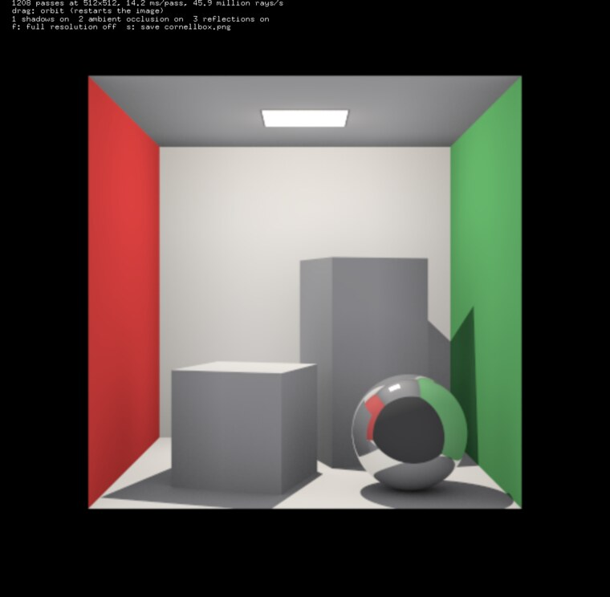
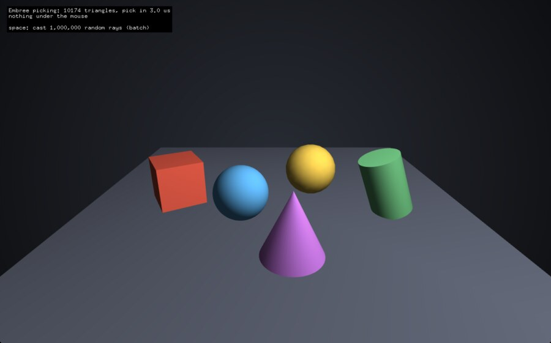

# ofxEmbreeRayTracing

[](https://github.com/danoli3/ofxEmbreeRayTracing/actions/workflows/ci.yml)

Ray tracing for openFrameworks on [Intel Embree 4](https://github.com/RenderKit/embree): fast ray / mesh
queries (nearest hit, shadows, mouse picking, millions of rays per second on all cores) and a progressive
CPU ray tracer with shadows, ambient occlusion and reflections.

<p align="center"></p>

## Scene: ray queries

```cpp
#include "ofxEmbreeRayTracing.h"

ofxEmbree::Scene scene;
unsigned box = scene.addMesh(ofMesh::box(100, 100, 100), node.getGlobalTransformMatrix());
unsigned ball = scene.addSphere({ 0, 200, 0 }, 50);

// nearest hit along a ray
ofxEmbree::Hit hit = scene.intersect(origin, direction);
if (hit) ofLog() << hit.geometry << " at " << hit.distance << ", normal " << hit.normal;

// what's under the mouse
hit = scene.pick(cam, { ofGetMouseX(), ofGetMouseY() });

// is anything in the way (shadow rays)
bool blocked = scene.occluded(ray);

// lots of rays on all cores
scene.intersect(rays, hits);
```

| | |
|---|---|
| `addMesh(mesh, transform)` | `OF_PRIMITIVE_TRIANGLES`, `_TRIANGLE_STRIP` or `_TRIANGLE_FAN`, indexed or not; returns the geometry id |
| `addSphere(center, radius)` | an analytic sphere |
| `remove(id)`, `clear()`, `commit()` | queries commit changes themselves; `commit()` lets you choose when |
| `intersect(ray)` / `intersect(origin, direction)` | nearest `Hit`: `distance`, `position`, `normal`, `uv`, `geometry`, `primitive` |
| `occluded(ray)` | anything between `near` and `far`, faster than `intersect` |
| `intersect(rays, hits)` | many rays, split across all cores |
| `pick(camera, screen[, viewport])`, `rayFromScreen(...)` | mouse picking with any `ofCamera` / `ofEasyCam` |
| `getBounds()`, `getNumTriangles()`, `getRTCScene()`, `getDevice()` | and the rest of the Embree API |

## Renderer: a CPU ray tracer

```cpp
ofxEmbree::Renderer renderer;
renderer.setMaterial(box, { ofFloatColor(0.8f, 0.2f, 0.2f) });
renderer.setMaterial(ball, { ofFloatColor(0.95f), 0.85f });   // mostly a mirror

// update(): one more pass every frame (reset() when the camera or scene changes)
renderer.render(scene, cam, width, height);
texture.loadData(renderer.getPixels());
```

Every pass traces a jittered ray per pixel on all cores and adds to the image, so it refines over time
(anti-aliased, with soft ambient occlusion). `settings`: a directional or point light, shadows, ambient
occlusion samples and distance, mirror bounces, ambient and background colours. Materials: colour,
reflection and emission.

## Examples

| Example | |
|---|---|
| `example_cornellbox` | a Cornell box with a mirror sphere, ray traced progressively; drag to orbit, toggle shadows / AO / reflections, save a PNG |
| `example_picking` | `of3dPrimitive`s with the shape under the mouse highlighted, the hit point and normal; space casts 1,000,000 rays in a batch |
| `example_tests` | the addon's tests, headless: distances and normals against known shapes, transforms, ranges, strips / fans, batches, picking through a camera, and a render with a shadow check |

<p align="center"></p>

On an Apple M-series laptop: about 12 million rays/s in the tests' small scene and 45 million rays/s in
the Cornell box (shadow and ambient occlusion rays included).

## Embree

`libs/embree` is Embree **4.4.1**, static, with Embree's internal task system (no TBB), built by the
scripts in `scripts/`:

| Folder | Code path | Script |
|---|---|---|
| `lib/osx` | universal: arm64 NEON, x86_64 AVX2 (Intel Macs from 2013) | `scripts/build_embree_macos.sh` (Xcode, CMake, Ninja) |
| `lib/linux64` | x86_64 SSE2 and AVX2, picked at runtime; `-fPIC` | `scripts/build_embree_linux.sh` (Docker) |
| `lib/linuxaarch64` | 64-bit ARM NEON (Raspberry Pi OS 64-bit, ARM servers); `-fPIC` | `scripts/build_embree_linux.sh arm64` |

Embree's static library allows one code path per architecture with Apple's clang, hence AVX2 only for
Intel Macs. Windows isn't included yet.

## License

ofxEmbreeRayTracing: MIT, Dan Rosser. Embree: Apache 2.0, Intel (`libs/embree/license`).
